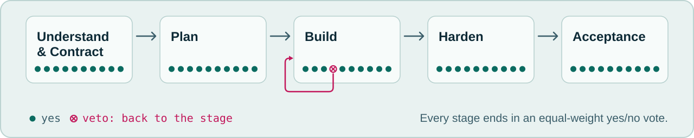

<picture>
  <source media="(prefers-color-scheme: dark)" srcset="assets/hero-dark.svg">
  <source media="(prefers-color-scheme: light)" srcset="assets/hero-light.svg">
  
</picture>

I build [SAMI](https://sami-agent.com), a desktop IDE where a council of AI models reviews and votes on every stage before code ships.
AI models can write code. The hard part is trusting it, so in SAMI the models debate and vote first.
I'm also studying AI Engineering at Masterschool.

## Now: SAMI

<picture>
  <source media="(prefers-color-scheme: dark)" srcset="assets/stages-dark.svg">
  <source media="(prefers-color-scheme: light)" srcset="assets/stages-light.svg">
  
</picture>

- **Adversarial Consensus.** Up to 10 models from different providers debate and vote at every stage. A single veto sends the work back, and dissent is recorded, not hidden.
- **Five stages, bounded rounds.** Each one ends in an equal-weight yes/no vote. Every stage, vote and artifact is stored and replayable.
- **Verification gate.** Type checks, linting and tests across six ecosystems. Autonomy levels L1 to L3, with guards against destructive commands.
- **Built end to end.** 470,000+ lines of original code, including 10,000+ automated tests. A VS Code-based desktop IDE (Electron, TypeScript) with Python/FastAPI, Next.js, Docker, nginx and self-healing ops behind it.

SAMI is in early access: [sami-agent.com](https://sami-agent.com).

## Toolbox

**AI** 

**Software** 

**Infrastructure** 

**Web3** 

## Before

On site in Frankfurt: IT rollouts, high-performance hardware and server infrastructure for enterprise and finance clients.

## Let's talk

Open to exceptional engineers for a CTO-track role, and to investors who want to walk through the architecture.

 

Frankfurt, Germany. The hero and the diagram are hand-written SVG files in this repository.

